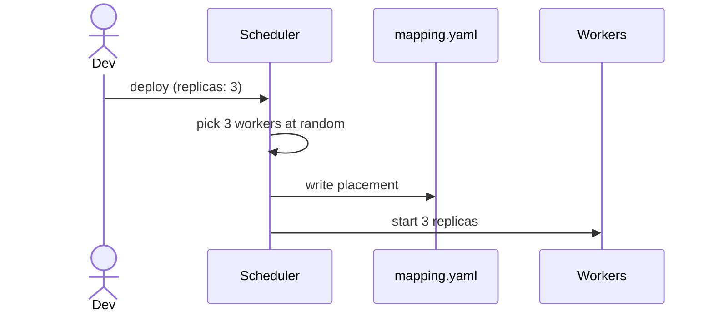

## Decision
When a service asks for `replicas: 3`, the scheduler picks 3 workers at random and writes the placement to `mapping.yaml`.

## Why
- Gets multi-replica deploys working with the least code.
- Good enough while every worker has the same capacity.

## Alternatives rejected
- Round robin: needs shared state about the last pick, for no real gain at this size.

## Diagram

