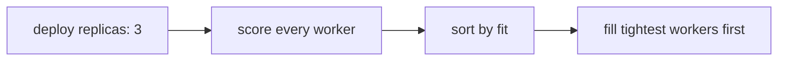

## Decision
Not adopted. Place replicas to fill the fewest workers, scoring every worker on CPU, memory and disk.

## Why rejected
- The scoring needs live resource numbers from every worker, which we do not collect yet.
- With fewer than 20 workers, constraint filtering gives the same result most of the time.
- Revisit if worker count or cost pressure grows.

## Diagram

